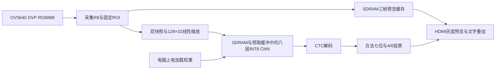

# 架构与数据合同

## 数据流

电脑关闭串口后自动推理继续。无停车记录、计时或数码管时钟。

## 摄像头与识别范围

摄像头配置为640×480 RGB888，FPGA取每像素R字节作为R8灰度。绿色ROI左上角为(128,176)，宽384、高128。按冻结的半像素中心/线性插值与逐级整数舍入合同缩放为128×32；软件和RTL使用同一预处理描述 `car_test/PL/teacher/video/preprocess.json`。

这是固定框内单张完整车牌识别，没有任意位置检测、倾斜校正或多车牌检测。实际模型为155316参数的八层教师，定义/训练逻辑见 `car_test/train/train_teacher.py` 和 `teacher_qat.py`；不要将 `model.py` 的默认七层学生配置当成本bit使用的教师。

## 时钟与存储

| 项目 | 参数 |
| --- | --- |
| 板载输入 | 50MHz |
| CNN、UART、像素 | 25MHz |
| 内存 | 75MHz，BL4/CAS3，450周期刷新 |
| SDRAM前向时钟 | 180°相移，DQ下降沿采样 |
| HDMI串行 | 125MHz |
| 相机XCLK | 24MHz |
| 合封SDRAM | 8MiB，`EG_PHY_SDRAM_2M_32` |

| SDRAM字节地址 | 内容 |
| --- | --- |
| 0x000000、0x04B000、0x096000 | 3个640×480单字节预览帧，共900KiB |
| 0x100000 | 156256字节模型 |
| 0x140000 | 4096字节输入ROI |
| 0x150000、0x190000 | 交替的层间特征 |

片内RAM保存异步FIFO、行/ROI快照、双输入窗口、8个权重银行和字库。大帧、权重主体及中间特征位于SDRAM。八路MAC执行时提前预取后续输入窗口和权重；缓冲区所有权和就绪握手避免覆盖仍在计算的数据。

单个SDRAM控制器在请求边界仲裁，视频最多连续3次后让一次CNN；请求一旦接受，地址、掩码、数据和读等待参数保持到响应。视频三帧缓存不写入显示端持有的帧，忙时丢弃过时快照而非覆盖已持有ROI。

## 数值、结果与显示

卷积采用有符号INT8权重、INT32累加、固定移位与饱和；最后一层输出按INT16读取。CTC使用68类字表，去空白、折叠连续重复，argmax同分取最低索引。

显示保留原始候选、字数、票数和确认状态。确认要求省份字符＋合法地区字母＋5个字母数字，共七位；I/O不作为普通车牌字母。最近6个不同且新鲜的源帧中至少4次整牌一致才确认，5秒窗口；错误、重复帧和过期结果不会累计为新票。

模型通过串口上传后由FPGA全量回读CRC，未通过时禁止启动推理。UART实际相机I结果与HDMI使用同一次FPGA结果；层CRC来自SDRAM特征的真实读回。
